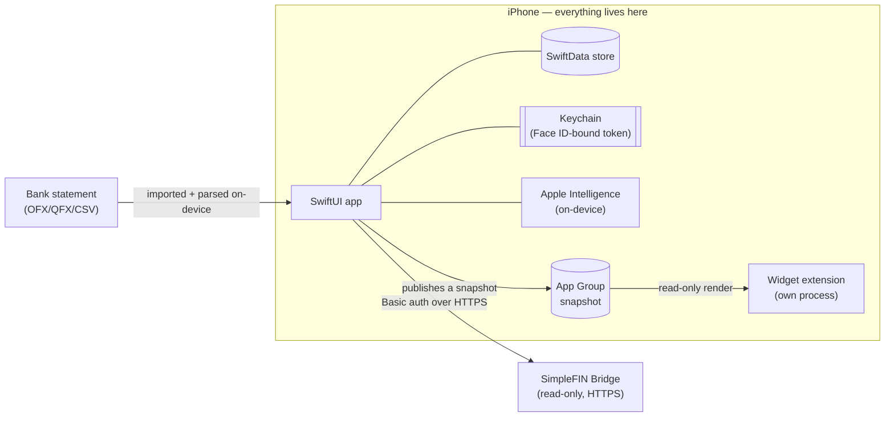
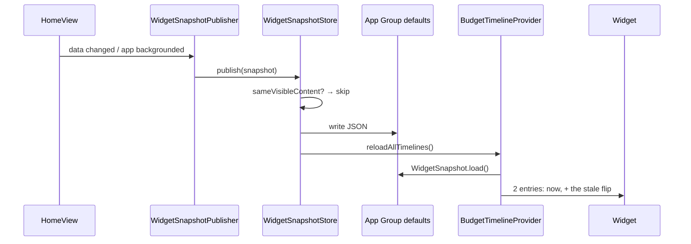
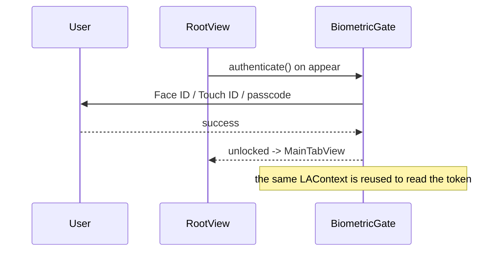
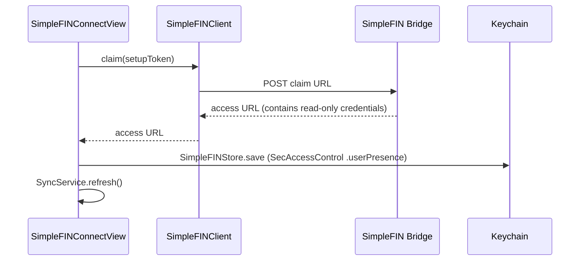
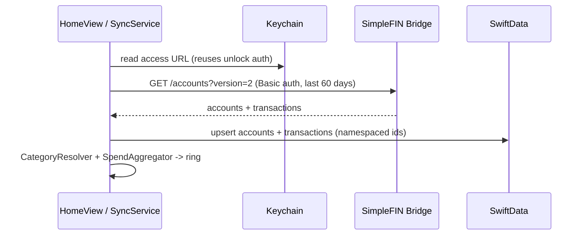
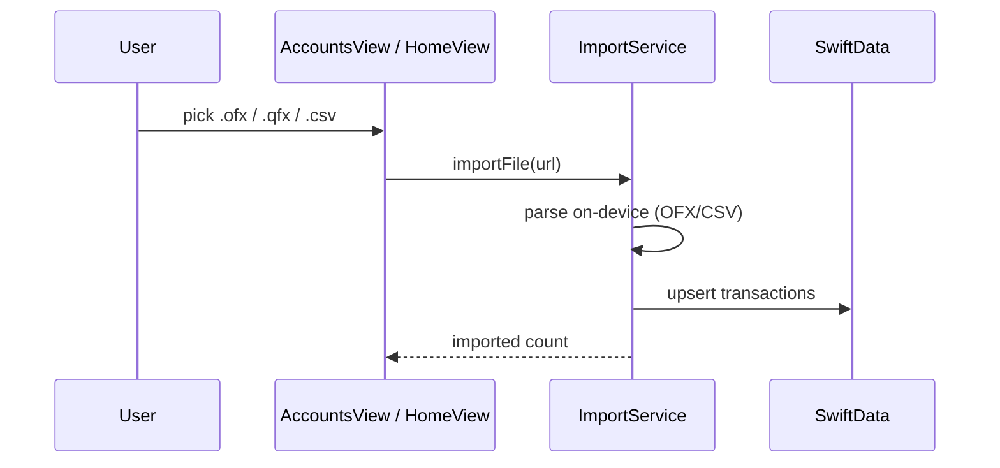
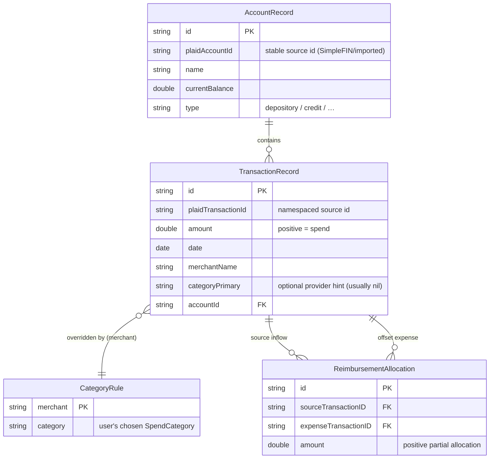

# PocketLocket — Architecture

This document explains how PocketLocket is put together so a reviewer can
understand the system without reading every file. It covers the components, the
data/security model, the end-to-end flows, and the key design decisions.

The app is **local-first and backend-free**: all financial data lives **only on
the device** (SwiftData + Keychain), and nothing is persisted on any server.
Bank data comes from one of two on-device sources — the **SimpleFIN Bridge**
(read-only, ~$15/yr, the recommended path) or **free OFX/QFX/CSV file import**.
On-device **Apple Intelligence** (iOS 26 Foundation Models) powers the Save-tab
insights, with a rules-based fallback.

---

## 1. Overview

PocketLocket is a personal iOS budgeting app. The home screen is a
**spend-categorizing ring**. The guiding principle is **privacy first**: no bank
credentials are ever entered in the app, and no financial data ever leaves the
device.

With SimpleFIN, you authenticate on SimpleFIN's own site and the app receives a
**read-only access URL** — never your bank login. That URL is the only credential
the app holds, and it is stored in the Keychain behind Face ID. File import
involves no credentials at all.



**Key rule:** the phone holds only (a) a read-only SimpleFIN access URL in the
Keychain and (b) a local store of already-fetched financial rows. There is no
server, no login account, and no shared secret. The widget process can reach
neither the store nor the Keychain — only the small snapshot the app chose to
publish.

---

## 2. Repository layout

```
ios/
  project.yml                 XcodeGen project definition (no .xcodeproj in git)
  Config/*.xcconfig           Build settings; Secrets.xcconfig optional + git-ignored
  PocketLocket/
    App/                      Entry point, RootView router, MainTabView, LockView
    Core/
      Security/               KeychainStore, BiometricGate, SimpleFINStore
      Networking/             SimpleFINClient (direct, read-only bridge access)
      Persistence/            AppModelContainer, SyncService
      Import/                 OFXParser, CSVParser, ImportService
      Widgets/                WidgetSnapshotPublisher (app → App Group)
    Models/                   SpendCategory, CategoryResolver, MerchantHeuristics,
                              SpendAggregator, SavingsAdvisor, AccountRecord,
                              TransactionRecord, CategoryRule,
                              ReimbursementAllocation
    Features/                 Home, Transactions, Accounts, Connect, Save, Settings
    DesignSystem/             Formatters
    Resources/                Info.plist, Assets
  PocketLocketTests/          Unit + snapshot tests
  Shared/                     App Group snapshot layer (compiled into BOTH targets)
  PocketLocketWidget/         WidgetKit extension: provider, intent, views
  PocketLocketWidgetTests/    Widget layout + readout tests (no host app)

scripts/bootstrap.sh          Installs tooling + generates the Xcode project
```

There is no `backend/` — the app is entirely self-contained.

---

## 3. iOS app architecture

The app is SwiftUI with a light **MVVM + services** structure. State uses the
Observation framework (`@Observable`) and SwiftData for the on-device store.


### Layer responsibilities

- **App/** — `RootView` shows `LockView` until `BiometricGate` reports unlocked,
  then `MainTabView` (Home / Transactions / Accounts / Insights). No sign-in step.
- **Core/Security** —
  - `KeychainStore`: generic-password Keychain wrapper. Standard items are
    `WhenUnlockedThisDeviceOnly`; it also offers **biometric-protected** items via
    `SecAccessControl(.userPresence)` and a prompt-free `exists()` check.
  - `BiometricGate`: `LAPolicy.deviceOwnerAuthentication` (Face ID/Touch ID with
    passcode fallback); locks on background. Holds a reusable `LAContext` so a
    successful unlock can read the protected token without a second prompt.
  - `SimpleFINStore`: stores the SimpleFIN access URL, **bound to Face ID**
    (falls back to standard Keychain on a device with no passcode); caches it in
    memory for the session.
- **Core/Networking** —
  - `SimpleFINClient`: talks to the bridge directly over HTTPS. `claim` exchanges
    a one-time setup token for an access URL; `fetchAccounts` reads accounts +
    transactions using HTTP Basic auth (credentials pulled from the access URL,
    never left in the request URL).
- **Core/Persistence** —
  - `AppModelContainer`: the SwiftData container
    (`AccountRecord`, `TransactionRecord`, `CategoryRule`).
  - `SyncService`: reads the biometric-bound access URL, fetches from SimpleFIN,
    and upserts accounts + transactions into SwiftData.
- **Core/Import** — `OFXParser`, `CSVParser`, and `ImportService` parse a picked
  statement file entirely on-device and merge it into the store.
- **Models** — domain types and the pure, testable `CategoryResolver` /
  `SpendAggregator`, plus SwiftData `@Model` records.
- **Features** — one folder per screen; views are thin, math lives in
  `HomeViewModel` / `SpendAggregator`.

### Why the ring math is separated

`SpendAggregator` and `HomeViewModel` operate on plain `SpendItem` values (not
SwiftData models). This keeps the budgeting math **pure and unit-testable**
without a database and lets the SwiftUI views stay declarative.

### The widget extension and `Shared/`

The widget is a separate target (`PocketLocketWidget`) running in its own
process. It cannot open the SwiftData store and cannot read the Face ID–bound
SimpleFIN token, so nothing is ever pulled — the app **pushes** a small
precomputed payload into an App Group container.

> This section covers the widget's *design*. For the practical guide — what the
> widgets show, and how to add, test, and debug them (`simctl`, the App Group
> container check, the `PocketLocketWidget` debug scheme) — see
> [`ios/PocketLocketWidget/README.md`](../ios/PocketLocketWidget/README.md).

`ios/Shared/` is compiled into *both* binaries, which is what keeps the two
sides from disagreeing about the same number:

| File | Role |
|------|------|
| `AppGroup.swift` | Resolves the App Group id from Info.plist; owns the shared `UserDefaults` suite. |
| `WidgetSnapshot.swift` | The `Codable` payload plus the pure `build(...)` that derives it from `[SpendItem]`. |
| `WidgetSnapshotStore.swift` | Publish / clear / `reloadAllTimelines()`, with dedupe on visible content. |
| `MonthlyPace.swift` | `daysLeftInMonth` and `SafeToSpendBasis` — extracted from `HomeView` so Home and the widget share one implementation. |
| `WidgetMetric.swift` | The headline metric (`percent` / `remaining` / `safeToSpend`), shared preference. |
| `WidgetReadout.swift`, `WidgetText.swift` | Wording and number formatting, identical on every size. |
| `WidgetDeepLink.swift` | `pocketlocket://widget/...` build + parse. |
| `WidgetPreferences.swift` | "Show amounts" and "Color ring by category" toggles, read by both sides. The color key is stored **inverted** (`widgetMonochromeRing`) because `UserDefaults.bool` reads `false` for an unwritten key — a plain "colorful" key would default the feature *off* for fresh installs and for existing installs updating past this version. |
| `WidgetRingSegment.swift` | Pure ring-segment math: splits the budget arc into per-category segments (`make(fraction:categories:limit:)`). Segments are exactly contiguous — no gap is reserved, because the view draws them last-to-first with round caps so each category's rounded end overlaps the next. Keeping a gap out of the model is what guarantees a thin category can never be dropped for being narrower than its own gap. Lives here rather than in the widget target so the arithmetic is unit-testable and the app could reuse it. |



Two decisions worth knowing:

- **The timeline has two entries, not a refresh schedule.** WidgetKit throttles
  self-refreshing timelines, so freshness comes from the app calling
  `reloadAllTimelines()`. The second entry is only the moment the snapshot
  crosses the staleness threshold, which is when the caption changes to
  *"as of 3h ago"*.
- **Amounts are absent, not hidden.** When *Show amounts* is off,
  `WidgetCategory.amount` is `nil` and the encoder omits the key, so no dollar
  figure exists in the shared file at all.

---

## 4. End-to-end flows

### 4.1 Unlock



### 4.2 Connect a bank (SimpleFIN)



### 4.3 Sync + render the ring



### 4.4 Import a statement



---

## 5. Security model

Threats considered: a stolen device and a decompiled binary.

- **No bank credentials on device.** With SimpleFIN you log in on SimpleFIN's
  site; the app only receives a **read-only** access URL. File import needs no
  credentials.
- **Biometric-bound token at rest.** The SimpleFIN access URL is stored via
  `SecAccessControl(.userPresence)` + `WhenUnlockedThisDeviceOnly`, so it can't
  be read or replaced without Face ID / Touch ID / passcode and never syncs to
  iCloud. A prompt-free `exists()` check is used for "connected?" UI state.
- **Biometric app lock.** `BiometricGate` requires Face ID/Touch ID (passcode
  fallback) on launch and re-locks when the app backgrounds. Its `LAContext` is
  reused so unlocking also authorizes the token read (no double prompt).
- **On-device intelligence.** `AIInsightService` uses Foundation Models locally;
  spending summaries never leave the device. Results are cached by input
  signature to avoid needless compute.
- **Transport security.** App Transport Security is on (HTTPS only). SimpleFIN
  credentials are sent as an `Authorization: Basic` header, never embedded in a
  request URL that could be logged.
- **No secrets in the app or git.** The bundle ships no API keys; there is no
  backend `.env`. `Secrets.xcconfig` is git-ignored and now only optionally holds
  a signing team override.
- **User-controlled erase.** *Settings → Reset local data* deletes all records
  and clears the stored token **and the widget snapshot**, so a widget can't keep
  showing figures from a ledger that's gone.
- **The widget sees only what you put on your Home Screen.** It runs in its own
  process with no access to the SwiftData store or the biometric-bound token; it
  reads one small precomputed JSON blob from an App Group container. Dollar
  amounts are omitted from that blob entirely unless *Settings → Widgets → Show
  amounts* is on. Widget taps route through `AppRouter`, which **queues** the
  destination rather than navigating, so a tap can never bypass the lock.

---

## 6. Data model

Everything is local SwiftData. Reimbursement allocations preserve the imported
ledger while letting one inflow offset portions of one or more purchases.



> The field names `plaidAccountId` / `plaidTransactionId` are historical; they
> are now just the stable identifier for any source (SimpleFIN ids are namespaced
> as `sf-<accountId>-<txnId>` because SimpleFIN reuses txn ids across accounts).

**Amount convention:** the app uses **positive = money spent**, negative =
income. SimpleFIN reports positive for deposits, so `SimpleFINMapper` negates
amounts on import. The ring sums positive amounts of spending categories only
(income/transfers excluded). A reimbursement allocation subtracts from the
linked purchase for budget and analysis math on that purchase's original date;
neither bank transaction is edited.

---

## 7. Categorization

Each transaction's category is resolved **on-device** by `CategoryResolver`, in
priority order:

1. **User rules** — a `CategoryRule` for the merchant (set by re-categorizing a
   transaction) always wins.
2. **Merchant heuristics** — `MerchantHeuristics` matches known merchants
   (specific-before-generic, e.g. "uber eats" → Food before "uber" → Transport).
3. **Provider hint** — any `categoryPrimary` mapped by `CategoryMapper` (present
   for imported data that carries one; typically nil for SimpleFIN).
4. **Fallback** — otherwise "Uncategorized".

Doing this on the client keeps the mapping easy to test and restyle, and lets the
user correct categories with a lasting rule.

---

## 8. AI insights (Save tab)

`AIInsightService` builds a short spending summary and asks Apple's on-device
model (`SystemLanguageModel` / `LanguageModelSession`) for 2–3 concise savings
tips. It is guarded by `#if canImport(FoundationModels)` + `if #available(iOS
26.0, *)` and reports `.unavailable` on older OSes / Simulators, where the
rules-based `SavingsAdvisor` suggestions are shown on their own. Output is cached
by a signature of the inputs so it only regenerates when spending changes.

---

## 9. Testing

- **Unit tests** (`PocketLocketTests`): `CategoryMapperTests` and
  `CategoryResolverTests` (rule > heuristic > provider > fallback, incl.
  case-insensitivity); `SpendAggregatorTests` (totals exclude
  income/transfers/refunds, sort order, budget math); `SavingsAdvisorTests`;
  `ImportParsersTests` (OFX/CSV); `SimpleFINTests` (amount negation, type
  inference, id namespacing).
- **Widget tests in the app bundle** (`WidgetSnapshotTests`,
  `WidgetPresentationTests`): snapshot encoding/decoding, the privacy rule that
  hidden amounts are *absent* from the bytes, publish dedupe, staleness, deep
  links, the metric cycle, and `SafeToSpendBasis` / `MonthlyPace` (so a change
  to Home's math can't silently diverge from the widget's).
- **Widget bundle tests** (`PocketLocketWidgetTests`): renders every family with
  `ImageRenderer` to `/tmp/widget_layouts` and asserts on the readout wording.
  It has no host app — an app extension's sources aren't in the app binary, so
  the target recompiles `Shared/` and the two model files itself. `\.widgetFamily`
  is read-only, which is why `BudgetWidgetEntryView` accepts the family as a
  parameter.
- **Snapshot tests** (`UISnapshotTests`): render each ring variant and the Home
  composition via `ImageRenderer` to catch layout regressions.

Run: `xcodebuild -project ios/PocketLocket.xcodeproj -scheme PocketLocket -destination 'platform=iOS Simulator,name=iPhone 17,OS=27.2' test` (353 tests across both bundles). Green on the iOS 27.2 simulator runtime; pass `OS=` to pick one, and note that `name=iPhone 17` only exists on 27.0 and later. The `PocketLocket` scheme is declared in `project.yml` so it picks up the widget test target too — an auto-generated scheme only includes test targets that depend on the app, and this one deliberately doesn't. Declaring schemes suppresses auto-generation, so `PocketLocketWidget` is declared too: building only the appex gives Xcode's "wait for the process to launch" mode, the only way to breakpoint inside the extension.

---

## 10. Configuration & signing

- The app needs **no secrets or configuration** to run.
- `ios/Config/Secrets.xcconfig` (git-ignored, optional) can override
  `DEVELOPMENT_TEAM`; otherwise signing uses the automatic team set in
  `project.yml` with bundle id `com.vratnakaram.PocketLocket`.
- **App Group** `group.<BUNDLE_ID_PREFIX>.PocketLocket` (set from
  `APP_GROUP_ID` in `Config/*.xcconfig`) is shared by the app and the widget
  extension, whose bundle id is the app's plus `.PocketLocketWidget`. The id is
  read at runtime from the `AppGroupIdentifier` Info.plist key, so changing the
  prefix in one xcconfig updates both. On a **physical device** the App Group
  entitlement requires the paid Apple Developer Program; the simulator doesn't
  check it.
- The Xcode project is generated by XcodeGen (`scripts/bootstrap.sh` or
  `cd ios && xcodegen generate`); the `.xcodeproj` is not committed.

---

## 11. Distribution

Because there's no backend, every install is self-contained (each user connects
their own SimpleFIN bridge or imports their own files).

- **This Mac / your own iPhone:** run from Xcode (free; 7-day signing on device).
- **TestFlight** (private link, up to 10,000 testers): requires the paid Apple
  Developer Program ($99/yr) — a private beta, not an App Store release.
- **AltStore / SideStore:** free sideloading with periodic re-signing.

---

## 12. Key decisions & trade-offs

- **No backend at all** — SimpleFIN provides read-only aggregation directly to
  the device and file import is inherently local, so the app needs no server,
  no secrets, and no login. This maximizes privacy and minimizes attack surface.
- **SimpleFIN over Plaid** — comparable coverage for personal use at a flat
  ~$15/yr with a read-only, device-to-bridge model, avoiding per-call API costs
  and a secret-holding relay.
- **Biometric-bound Keychain token** — the one credential the app holds requires
  user presence to read, matching the sensitivity of financial access.
- **SwiftData as the source of truth** — offline viewing and a snappy UI; sync is
  an idempotent upsert from SimpleFIN, and import merges into the same store.
- **Pure, testable domain layer** — categorization and aggregation are plain
  value types, independent of SwiftData and UI.
- **The widget reads a snapshot, never the store** — a widget extension is a
  separate process with no access to the SwiftData file or the biometric-bound
  token, so the app publishes a small precomputed payload into an App Group and
  the widget only renders it. Costs a little duplication of "what's fresh";
  buys a widget that can't leak the ledger and can't fail on a locked Keychain.
- **One shared metric preference instead of per-widget configuration** — the
  cycle button, the long-press menu and Settings all write one key, so every
  widget on the Home Screen agrees. A `@Parameter` would have added a fourth,
  contradictory place to set it.
- **The colored ring is still a budget ring** — segments divide the *filled*
  arc, so length keeps answering "how much of my budget is gone" and color
  answers "on what". A full-circle category donut (the obvious choice, and what
  most budgeting widgets do) would have thrown away the widget's primary read:
  you could no longer see at a glance whether you're near your limit. Two rules
  keep the legend honest — the ring never names more categories than the layout
  lists rows (`WidgetRingSegments.displayedCategories` is 3, matching the medium
  widget; large passes `categories.count`), and the unattributed remainder is
  drawn in a pale neutral rather than a category tint, because every saturated
  color already means a specific category.
