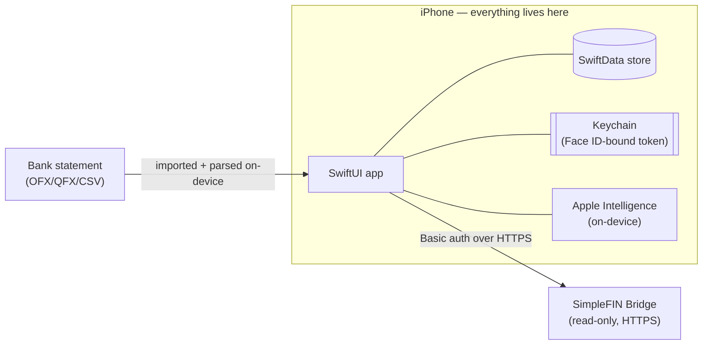
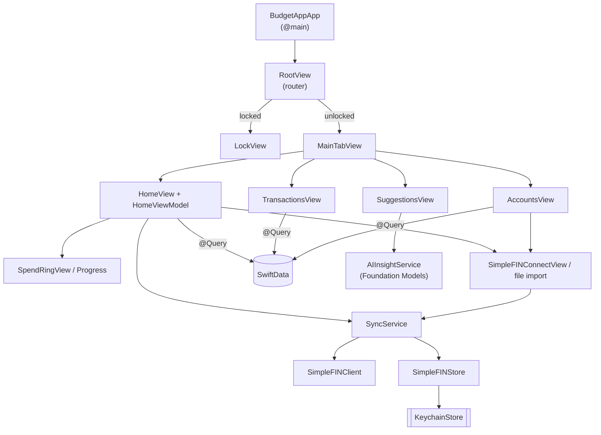
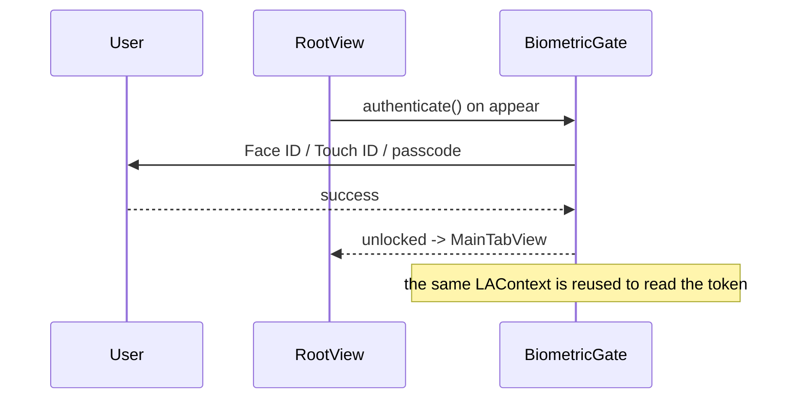
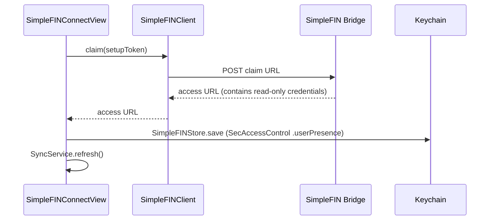
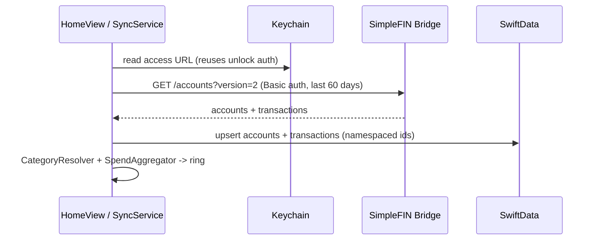
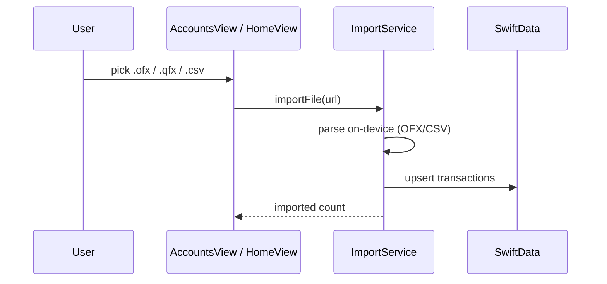
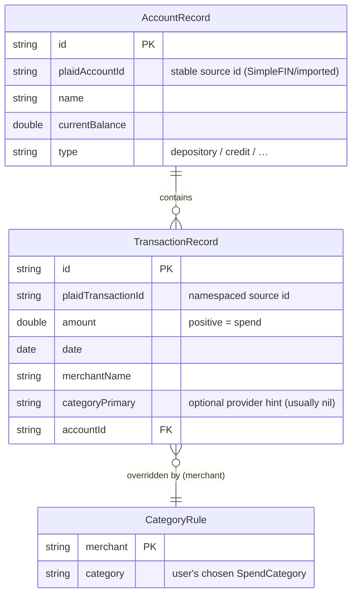

# Budget App — Architecture

This document explains how the Budget App is put together so a reviewer can
understand the system without reading every file. It covers the components, the
data/security model, the end-to-end flows, and the key design decisions.

The app is **local-first and backend-free**: all financial data lives **only on
the device** (SwiftData + Keychain), and nothing is persisted on any server.
Bank data comes from one of two on-device sources — the **SimpleFIN Bridge**
(read-only, ~$15/yr, the recommended path) or **free OFX/QFX/CSV file import**.
On-device **Apple Intelligence** (iOS 26 Foundation Models) powers the Save-tab
insights, with a rules-based fallback.

---

## 1. Overview

Budget App is a personal iOS budgeting app. The home screen is a
**spend-categorizing ring**. The guiding principle is **privacy first**: no bank
credentials are ever entered in the app, and no financial data ever leaves the
device.

With SimpleFIN, you authenticate on SimpleFIN's own site and the app receives a
**read-only access URL** — never your bank login. That URL is the only credential
the app holds, and it is stored in the Keychain behind Face ID. File import
involves no credentials at all.



**Key rule:** the phone holds only (a) a read-only SimpleFIN access URL in the
Keychain and (b) a local store of already-fetched financial rows. There is no
server, no login account, and no shared secret.

---

## 2. Repository layout

```
ios/
  project.yml                 XcodeGen project definition (no .xcodeproj in git)
  Config/*.xcconfig           Build settings; Secrets.xcconfig optional + git-ignored
  BudgetApp/
    App/                      Entry point, RootView router, MainTabView, LockView
    Core/
      Security/               KeychainStore, BiometricGate, SimpleFINStore
      Networking/             SimpleFINClient (direct, read-only bridge access)
      Persistence/            AppModelContainer, SyncService
      Import/                 OFXParser, CSVParser, ImportService
    Models/                   SpendCategory, CategoryResolver, MerchantHeuristics,
                              SpendAggregator, SavingsAdvisor, AccountRecord,
                              TransactionRecord, CategoryRule
    Features/                 Home, Transactions, Accounts, Connect, Save, Settings
    DesignSystem/             Formatters
    Resources/                Info.plist, Assets
  BudgetAppTests/             Unit + snapshot tests

scripts/bootstrap.sh          Installs tooling + generates the Xcode project
```

There is no `backend/` — the app is entirely self-contained.

---

## 3. iOS app architecture

The app is SwiftUI with a light **MVVM + services** structure. State uses the
Observation framework (`@Observable`) and SwiftData for the on-device store.



### Layer responsibilities

- **App/** — `RootView` shows `LockView` until `BiometricGate` reports unlocked,
  then `MainTabView` (Home / Transactions / Accounts / Save). No sign-in step.
- **Core/Security** —
  - `KeychainStore`: generic-password Keychain wrapper. Standard items are
    `WhenUnlockedThisDeviceOnly`; it also offers **biometric-protected** items via
    `SecAccessControl(.userPresence)` and a prompt-free `exists()` check.
  - `BiometricGate`: `LAPolicy.deviceOwnerAuthentication` (Face ID/Touch ID with
    passcode fallback); locks on background. Holds a reusable `LAContext` so a
    successful unlock can read the protected token without a second prompt.
  - `SimpleFINStore`: stores the SimpleFIN access URL, **bound to Face ID**
    (falls back to standard Keychain on a device with no passcode); caches it in
    memory for the session.
- **Core/Networking** —
  - `SimpleFINClient`: talks to the bridge directly over HTTPS. `claim` exchanges
    a one-time setup token for an access URL; `fetchAccounts` reads accounts +
    transactions using HTTP Basic auth (credentials pulled from the access URL,
    never left in the request URL).
- **Core/Persistence** —
  - `AppModelContainer`: the SwiftData container
    (`AccountRecord`, `TransactionRecord`, `CategoryRule`).
  - `SyncService`: reads the biometric-bound access URL, fetches from SimpleFIN,
    and upserts accounts + transactions into SwiftData.
- **Core/Import** — `OFXParser`, `CSVParser`, and `ImportService` parse a picked
  statement file entirely on-device and merge it into the store.
- **Models** — domain types and the pure, testable `CategoryResolver` /
  `SpendAggregator`, plus SwiftData `@Model` records.
- **Features** — one folder per screen; views are thin, math lives in
  `HomeViewModel` / `SpendAggregator`.

### Why the ring math is separated

`SpendAggregator` and `HomeViewModel` operate on plain `SpendItem` values (not
SwiftData models). This keeps the budgeting math **pure and unit-testable**
without a database and lets the SwiftUI views stay declarative.

---

## 4. End-to-end flows

### 4.1 Unlock



### 4.2 Connect a bank (SimpleFIN)



### 4.3 Sync + render the ring



### 4.4 Import a statement



---

## 5. Security model

Threats considered: a stolen device and a decompiled binary.

- **No bank credentials on device.** With SimpleFIN you log in on SimpleFIN's
  site; the app only receives a **read-only** access URL. File import needs no
  credentials.
- **Biometric-bound token at rest.** The SimpleFIN access URL is stored via
  `SecAccessControl(.userPresence)` + `WhenUnlockedThisDeviceOnly`, so it can't
  be read or replaced without Face ID / Touch ID / passcode and never syncs to
  iCloud. A prompt-free `exists()` check is used for "connected?" UI state.
- **Biometric app lock.** `BiometricGate` requires Face ID/Touch ID (passcode
  fallback) on launch and re-locks when the app backgrounds. Its `LAContext` is
  reused so unlocking also authorizes the token read (no double prompt).
- **On-device intelligence.** `AIInsightService` uses Foundation Models locally;
  spending summaries never leave the device. Results are cached by input
  signature to avoid needless compute.
- **Transport security.** App Transport Security is on (HTTPS only). SimpleFIN
  credentials are sent as an `Authorization: Basic` header, never embedded in a
  request URL that could be logged.
- **No secrets in the app or git.** The bundle ships no API keys; there is no
  backend `.env`. `Secrets.xcconfig` is git-ignored and now only optionally holds
  a signing team override.
- **User-controlled erase.** *Settings → Reset local data* deletes all records
  and clears the stored token.

---

## 6. Data model

Everything is local SwiftData. Two records back the UI; a third stores learned
category overrides.



> The field names `plaidAccountId` / `plaidTransactionId` are historical; they
> are now just the stable identifier for any source (SimpleFIN ids are namespaced
> as `sf-<accountId>-<txnId>` because SimpleFIN reuses txn ids across accounts).

**Amount convention:** the app uses **positive = money spent**, negative =
income. SimpleFIN reports positive for deposits, so `SimpleFINMapper` negates
amounts on import. The ring sums positive amounts of spending categories only
(income/transfers excluded).

---

## 7. Categorization

Each transaction's category is resolved **on-device** by `CategoryResolver`, in
priority order:

1. **User rules** — a `CategoryRule` for the merchant (set by re-categorizing a
   transaction) always wins.
2. **Merchant heuristics** — `MerchantHeuristics` matches known merchants
   (specific-before-generic, e.g. "uber eats" → Food before "uber" → Transport).
3. **Provider hint** — any `categoryPrimary` mapped by `CategoryMapper` (present
   for imported data that carries one; typically nil for SimpleFIN).
4. **Fallback** — otherwise "Uncategorized".

Doing this on the client keeps the mapping easy to test and restyle, and lets the
user correct categories with a lasting rule.

---

## 8. AI insights (Save tab)

`AIInsightService` builds a short spending summary and asks Apple's on-device
model (`SystemLanguageModel` / `LanguageModelSession`) for 2–3 concise savings
tips. It is guarded by `#if canImport(FoundationModels)` + `if #available(iOS
26.0, *)` and reports `.unavailable` on older OSes / Simulators, where the
rules-based `SavingsAdvisor` suggestions are shown on their own. Output is cached
by a signature of the inputs so it only regenerates when spending changes.

---

## 9. Testing

- **Unit tests** (`BudgetAppTests`): `CategoryMapperTests` and
  `CategoryResolverTests` (rule > heuristic > provider > fallback, incl.
  case-insensitivity); `SpendAggregatorTests` (totals exclude
  income/transfers/refunds, sort order, budget math); `SavingsAdvisorTests`;
  `ImportParsersTests` (OFX/CSV); `SimpleFINTests` (amount negation, type
  inference, id namespacing).
- **Snapshot tests** (`UISnapshotTests`): render each ring variant and the Home
  composition via `ImageRenderer` to catch layout regressions.

Run: `xcodebuild -project ios/BudgetApp.xcodeproj -scheme BudgetApp -destination 'platform=iOS Simulator,name=iPhone 17' test` (27 tests).

---

## 10. Configuration & signing

- The app needs **no secrets or configuration** to run.
- `ios/Config/Secrets.xcconfig` (git-ignored, optional) can override
  `DEVELOPMENT_TEAM`; otherwise signing uses the automatic team set in
  `project.yml` with bundle id `com.vratnakaram.BudgetApp`.
- The Xcode project is generated by XcodeGen (`scripts/bootstrap.sh` or
  `cd ios && xcodegen generate`); the `.xcodeproj` is not committed.

---

## 11. Distribution

Because there's no backend, every install is self-contained (each user connects
their own SimpleFIN bridge or imports their own files).

- **This Mac / your own iPhone:** run from Xcode (free; 7-day signing on device).
- **TestFlight** (private link, up to 10,000 testers): requires the paid Apple
  Developer Program ($99/yr) — a private beta, not an App Store release.
- **AltStore / SideStore:** free sideloading with periodic re-signing.

---

## 12. Key decisions & trade-offs

- **No backend at all** — SimpleFIN provides read-only aggregation directly to
  the device and file import is inherently local, so the app needs no server,
  no secrets, and no login. This maximizes privacy and minimizes attack surface.
- **SimpleFIN over Plaid** — comparable coverage for personal use at a flat
  ~$15/yr with a read-only, device-to-bridge model, avoiding per-call API costs
  and a secret-holding relay.
- **Biometric-bound Keychain token** — the one credential the app holds requires
  user presence to read, matching the sensitivity of financial access.
- **SwiftData as the source of truth** — offline viewing and a snappy UI; sync is
  an idempotent upsert from SimpleFIN, and import merges into the same store.
- **Pure, testable domain layer** — categorization and aggregation are plain
  value types, independent of SwiftData and UI.
